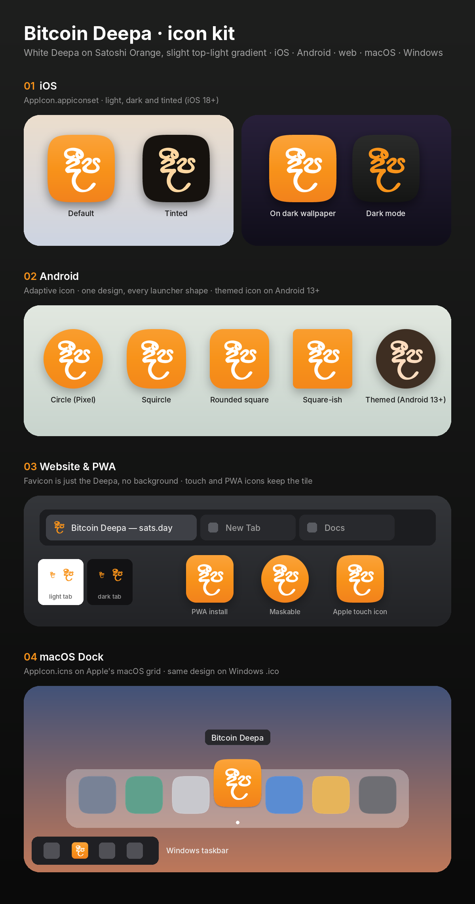

# Bitcoin Deepa — app icon kit

White **දීප** on Satoshi Orange with a slight top-light gradient
(`#FBA33A → #F8931A → #F2821C`, top to bottom). The glyph is the brand's own
දීප vector from the wordmark, never retyped. Every PNG is rendered from SVG.



**In this repo** the web icons are already wired up: `src/app/favicon.ico`,
`public/icons/` (favicon, PWA and maskable icons), `public/apple-touch-icon.png`,
`src/app/layout.tsx` (metadata icons) and `src/app/manifest.ts`. The other
folders are for native builds (iOS, Android, macOS, Windows) and for design work.

| Folder     | What it's for                                                                                                                          |
| ---------- | -------------------------------------------------------------------------------------------------------------------------------------- |
| `source/`  | Vector masters: light icon, dark icon, white දීප glyph on its own                                                                      |
| `ios/`     | Xcode `AppIcon.appiconset` (1024 light + iOS 18 dark + tinted) and legacy sizes                                                        |
| `android/` | `res/` folders to drop into an app: adaptive icon (background, foreground, themed monochrome), legacy icons, Play Store 512            |
| `web/`     | Favicon (just the දීප in Satoshi Orange, transparent background), Apple touch icon, PWA icons (including maskable), `site.webmanifest` |
| `macos/`   | Dock/Finder icon on Apple's macOS grid (824px body on 1024, soft shadow): `AppIcon.icns` + `AppIcon.iconset`                           |
| `windows/` | `BitcoinDeepa.ico` (16–256) for desktop apps and shortcuts                                                                             |

## Sizing rules used

- **Standard:** glyph is 66% of the tile height (iOS, Play Store, Apple touch icon).
- **Favicon:** just the දීප, no background, in Satoshi Orange `#F8931A` so it shows on both light and dark browser tabs. It fills the square; strokes are slightly thickened at 16 and 32px so the loop survives.
- **Other small icons (48px and below, Windows/macOS):** glyph enlarged to 80% of the tile (brand large-glyph rule); strokes slightly thickened at 16–24px.
- **Android adaptive:** glyph is 44% of the 108dp canvas, which equals 66% of the visible 72dp icon. It sits inside the 66dp safe circle, so circle, squircle and rounded-square launchers all crop it cleanly.
- **PWA maskable:** glyph kept inside the 40% safe circle.

## Web — paste into `<head>`

```html
<link rel="icon" href="/favicon.ico" sizes="any" />
<link rel="icon" href="/favicon.svg" type="image/svg+xml" />
<link rel="apple-touch-icon" href="/apple-touch-icon.png" />
<link rel="manifest" href="/site.webmanifest" />
<meta name="theme-color" content="#000000" />
```

Copy everything in `web/` to the site root. The Apple touch icon and PWA icons keep
the orange tile on purpose: iOS fills a transparent touch icon with black, and
installed apps need a solid tile.

## iOS

Drag `ios/AppIcon.appiconset` into `Assets.xcassets` (replace the existing AppIcon).
Xcode 16+ generates every size from the 1024 master; the dark and tinted versions
are picked up automatically on iOS 18+. `legacy-sizes/` is for older pipelines that
need individual files.

## Android

Merge `android/res/` into `app/src/main/res/`. Keep
`android:icon="@mipmap/ic_launcher"` and `android:roundIcon="@mipmap/ic_launcher_round"`
in the manifest. The monochrome layer gives Android 13+ themed icons.
Upload `playstore-icon-512.png` to Play Console (Google applies the mask).

## macOS

Use `macos/AppIcon.icns` directly (Electron/Tauri: point the build config at it). On a Mac
you can rebuild the .icns from the folder with
`iconutil -c icns macos/AppIcon.iconset`.

## Windows

`windows/BitcoinDeepa.ico` contains 16, 24, 32, 48, 64, 128 and 256px.

## Brand note

The brand page currently specifies a plain two-colour app icon tile with no gradient.
This kit adds a slight gradient, so update the App Icon section of
bitcoindeepa.com/brand if this becomes the standard.
